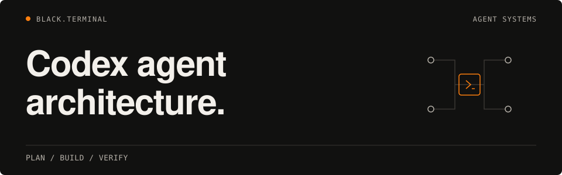
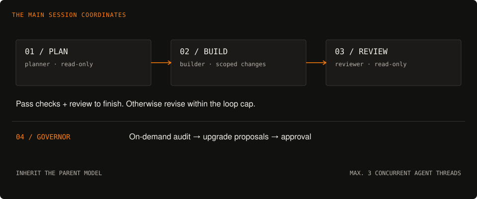

<h1>
  <picture>
    <source media="(max-width: 600px)" srcset="assets/readme/hero-mobile.svg">
    
  </picture>
</h1>

Four specialist agents. Three workflow skills. One Codex session coordinating the work.

**[Quick start](#quick-start)** · [Architecture](#architecture) · [Installation](#installation) · [Verification](#verification) · [Documentation](#documentation)

Native agent configuration, bounded loops, and a reversible installer for the BLACK.TERMINAL Codex setup. The main session plans and delegates; specialists handle focused tasks and review the result.

## Quick start

Open the repository in Codex. Its project agents and skills are discovered locally; personal installation is optional.

```bash
cd ~/Projects/multi-agent-system-architecture-codex
codex
```

Then ask:

> Read AGENTS.md, CODEX.md, and BUILD.md before making changes.

Use **`$orchestrate`** to plan delegation, **`$closed-loop`** to implement with a verification gate, or **`$loop`** for a bounded recurring check.

## Architecture

<picture>
  <source media="(max-width: 600px)" srcset="assets/readme/architecture-mobile.svg">
  
</picture>

| Agent | Responsibility | Working scope |
| :--- | :--- | :--- |
| **[planner](.codex/agents/planner.toml)** | A 3–7 phase plan with trade-offs and acceptance criteria | Read-only |
| **[builder](.codex/agents/builder.toml)** | Focused implementation in isolated parallel work | 1–5 files per task |
| **[reviewer](.codex/agents/reviewer.toml)** | Independent review for the closed-loop gate | Read-only |
| **[governor](.codex/agents/governor.toml)** | Audit findings and dated upgrade proposals | Writes proposals only; changes require approval |

The main session is the orchestrator. Agents inherit its model, provider, and reasoning effort; concurrent agent threads are capped at three. Native delegation and the three skills supply the workflow. See [CODEX.md](CODEX.md) for permissions and configuration details.

## Installation

This repository has no application dependency-install step. Interactive use requires Codex CLI; repository checks require Bash, Python **3.11+**, and standard Unix tools.

For an optional personal installation, inspect the installer and preview the four agent copies:

```bash
scripts/install-codex-local.sh --agents-only
```

Apply only with explicit approval:

```bash
scripts/install-codex-local.sh --agents-only --apply
scripts/smoke-test-codex.sh --live --agents-only
```

The agents-only mode preserves canonical personal skills. The default full installer also manages skill symlinks and refuses existing skill directories before changing anything. Applied changes have backups and a rollback manifest. [Installation and rollback →](CODEX.md#local-installation-approval-required)

## Verification

Before editing, read `AGENTS.md`, `README.md`, `PLAN.md`, `BUILD.md`, and `CODEX.md`. Use a feature branch and preserve unrelated work. The marked Claude-era sections are historical records.

The repository checks require Bash, Python **3.11+** (`tomllib`), and standard Unix tools. Codex CLI is needed for interactive use; the repository smoke test skips its CLI check when Codex is unavailable. ShellCheck is optional locally and required by CI.

From the repository root, these checks validate shell syntax, skill contracts, agent TOML, discovery links, and repository configuration without installing anything:

```bash
bash -n scripts/install-codex-local.sh
bash -n scripts/smoke-test-codex.sh
bash -n scripts/eval-skill-smoke.sh
bash -n scripts/codex-health.sh
scripts/eval-skill-smoke.sh
scripts/codex-health.sh --repo
git diff --check
```

The health command above runs `scripts/smoke-test-codex.sh --repo`; it does not check personal installations or provider access. If ShellCheck is already installed, also run the CI lint command:

```bash
shellcheck -x scripts/install-codex-local.sh scripts/smoke-test-codex.sh scripts/eval-skill-smoke.sh scripts/codex-health.sh
```

## Maintenance

Run the compact, read-only health check after a Codex update and monthly:

```bash
scripts/codex-health.sh          # repo contracts + local CLI/config health
scripts/codex-health.sh --repo   # repository contracts only
scripts/codex-health.sh --local  # local Codex/config inventories only
```

It validates config syntax, profiles, the repository contract, and CLI inventories. It does not install or update anything, start MCP servers, or run hooks. `codex doctor` may perform its own redacted provider reachability diagnostic.

The governor runs **on demand** before substantial changes or after a Codex upgrade. Review its `UPGRADE-PROPOSALS.md`, apply approved items, then run the smoke test after installation. Access to BSELA or other private data requires separate task authorization.

## Documentation

| Read | For |
| :--- | :--- |
| [CODEX.md](CODEX.md) | Current agents, permissions, skill discovery, installation, and rollback |
| [AGENTS.md](AGENTS.md) | Repository working rules |
| [BUILD.md](BUILD.md#phase-h--canonical-personal-library-compatibility-2026-10-12) | Verified migration and installation record |
| [PLAN.md](PLAN.md) | Accepted architecture and explicitly marked design history |
| [Harness map](reference/harness-map.md) | How the native surfaces fit together |
| [README design](reference/readme-design.md) | Shared visual conventions for the project family |
| [SECURITY.md](SECURITY.md) | Security boundaries and reporting |

<details>
<summary>Repository layout</summary>

```text
.codex/agents/   Four canonical agent definitions
.codex/config.toml
skills/          orchestrate · closed-loop · loop
.agents/skills/  Repository skill-discovery symlinks
scripts/         Installer, smoke tests, and health checks
reference/       Architecture and design references
assets/readme/   Static README artwork
.github/         Repository validation workflow
```

</details>

<details>
<summary>Migration history</summary>

The Codex-native rebuild was completed on 2026-09-13. Claude Code and Cursor were retired on that date. Earlier build phases remain in `BUILD.md`, and the removed files remain in Git history. Current installation acceptance is recorded in Phase H.

</details>

---

 **BLACK.TERMINAL** · [MIT License](LICENSE) · [GitHub](https://github.com/subkoks)
