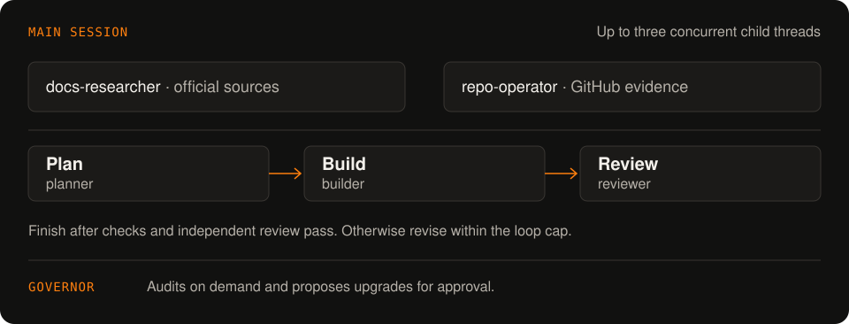

# Codex multi-agent architecture

A native OpenAI Codex setup for coordinating custom subagents, running bounded implementation and review workflows, and verifying changes before delivery. Open this repository in the Codex desktop app, CLI or IDE extension to use its six specialist roles and three workflow skills.

<picture>
  <source media="(max-width: 600px)" srcset="assets/readme/hero-mobile.svg">
  
</picture>

[Quick start](#quick-start) · [Architecture](#architecture) · [Installation](#installation) · [Verification](#verification) · [Maintenance](#maintenance) · [Documentation](#documentation)

## Quick start

Clone the repository and open its folder in Codex. In the CLI, run:

```bash
git clone https://github.com/subkoks/multi-agent-system-architecture-codex.git
cd multi-agent-system-architecture-codex
codex
```

Trust the checkout after inspecting `AGENTS.md` and `.codex/config.toml`. Try one of these workflows:

| Skill | Example |
| --- | --- |
| `$orchestrate` | Plan a configuration update. Ask the documentation researcher to verify the changed settings. |
| `$closed-loop` | Implement the plan, run the repository checks and ask the reviewer to assess the diff. |
| `$loop` | Check the required GitHub job every five minutes. Stop when it finishes or after six checks. |

## Architecture

The main session gathers evidence, plans the change, integrates implementation and runs the review gate. It can keep up to three child threads open. The governor audits the setup and returns upgrade proposals on demand.

<picture>
  <source media="(max-width: 600px)" srcset="assets/readme/architecture-mobile.svg">
  
</picture>

| Agent | Responsibility |
| --- | --- |
| [planner](.codex/agents/planner.toml) | Phase the work and define risks, ownership and acceptance checks. |
| [builder](.codex/agents/builder.toml) | Implement a bounded assignment with explicit file ownership. |
| [reviewer](.codex/agents/reviewer.toml) | Independently review the diff and the evidence for the verification gate. |
| [docs-researcher](.codex/agents/docs-researcher.toml) | Verify current platform behavior against official documentation and release notes. |
| [repo-operator](.codex/agents/repo-operator.toml) | Inspect GitHub settings, checks, branches and release evidence within the assigned scope. |
| [governor](.codex/agents/governor.toml) | Audit configuration, roles and skills and propose upgrades. |

Start with the parent model and only the delegation needed for the task. See [model and tool choices](CODEX.md#models-tools-and-usage) for lighter scans, higher-effort review, live search and OpenAI Docs MCP.

## Installation

Opening a trusted checkout loads the project configuration. To reuse the agents across projects, inspect the optional personal install and preview the copies:

```bash
scripts/install-codex-local.sh --agents-only
```

After explicit approval, apply and verify the personal installation:

```bash
scripts/install-codex-local.sh --agents-only --apply
scripts/smoke-test-codex.sh --live --agents-only
```

The installer backs up existing roles. Use the recorded manifest to restore them. [Installation and rollback](CODEX.md#local-installation-approval-required)

## Verification

The offline checks require Bash and Python 3.11+. Use ShellCheck for the same lint job that runs in GitHub Actions.

```bash
scripts/eval-skill-smoke.sh --quiet
scripts/codex-health.sh --repo --quiet
python3 scripts/check-quiet-diagnostics.py
python3 scripts/check-installer-migration.py
shellcheck -x scripts/install-codex-local.sh scripts/smoke-test-codex.sh scripts/eval-skill-smoke.sh scripts/codex-health.sh
git diff --check
```

With a current Codex CLI, run the isolated startup-config probe. It checks that Codex loads the repo configuration and rejects an unknown setting in a disposable project.

```bash
python3 scripts/check-codex-config.py
```

## Maintenance

Run the repository checks after changing agents, skills or configuration. Use the governor for a scoped audit after a Codex upgrade or when tool behavior changes. [Maintenance and usage measurements](CODEX.md#maintenance)

## Documentation

| Read | For |
| --- | --- |
| [CODEX.md](CODEX.md) | Agent scopes, model and tool selection, verification, installation and rollback |
| [AGENTS.md](AGENTS.md) | Repository working rules |
| [PLAN.md](PLAN.md) | Current architecture plan, audit findings and acceptance checks |
| [BUILD.md](BUILD.md) | Implementation and migration record |
| [Harness map](reference/harness-map.md) | How the native Codex surfaces fit together |
| [README design](reference/readme-design.md) | Brand, accessibility and GitHub metadata |
| [SECURITY.md](SECURITY.md) | Reporting, permission boundaries and installer safety |

---

 **BLACK.TERMINAL** · [MIT License](LICENSE) · [GitHub](https://github.com/subkoks)
